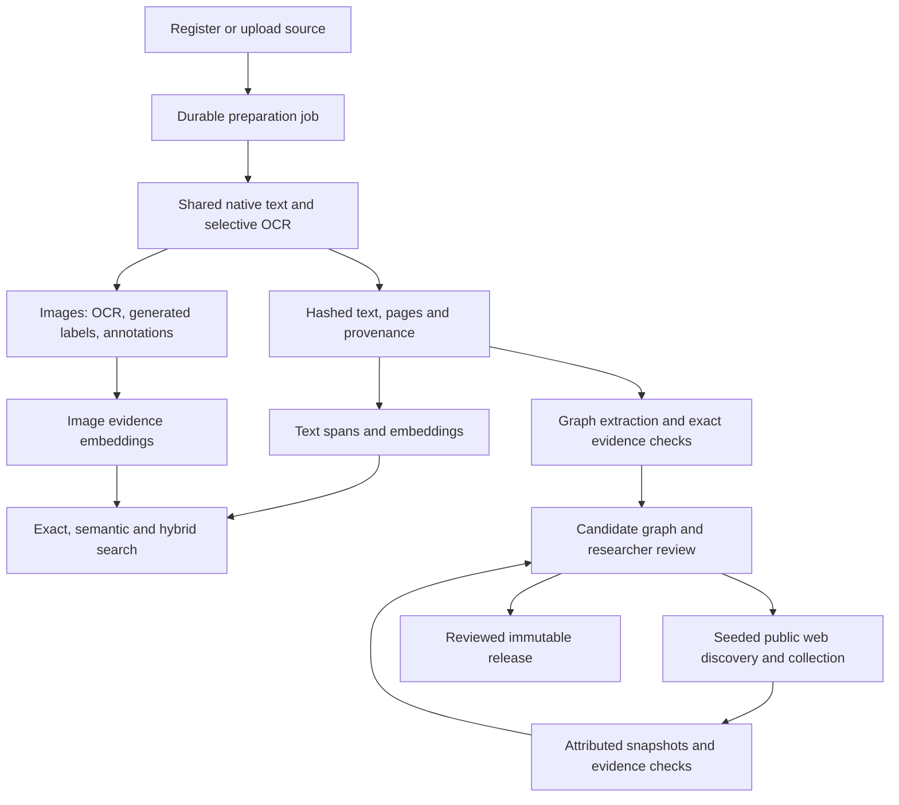

# Document preparation implementation and acceptance

Implemented on `codex/document-processing-poc`, 19 October 2026. Production remains on `codex/mvp-document-graphs` until staging acceptance. The approved Simplified Chinese, Traditional Chinese and Japanese Tesseract packs are the only added runtime dependencies. There are no database migrations, provider credential changes or production deployment configuration changes.

## Data flow



CPU parsing runs off the API event loop. Two preparation workers are bounded by per-material file locks. Graph jobs use a separate durable scheduler. Text and image indexing are independent after extraction. A graph stage checkpoint means that a run was registered/queued; it does not mean extraction or scientific review completed.

## Repeatable service contract

1. Upload commits the managed source and queues preparation. `POST /api/v1/repository/materials/{id}/process` reuses the current input/configuration fingerprint; `force: true` explicitly creates another preparation attempt.
2. The fingerprint covers source hashes, filenames/language, OCR engine/languages, shared parser implementation, graph prompt, image description recipe/model and embedding method identity. Source bytes are rechecked between stages and before completion. Changed inputs supersede the obsolete plan.
3. `document_representation.py` preserves immutable native/OCR outputs, exact text hashes, locators and confidence/warnings. Corrupt native PDF text falls back to OCR. Incomplete OCR remains retryable. Image descriptions remain a separate derived layer, never source quotations.
4. `processing_jobs.py` saves stage and per-item progress on the existing volume. Restart reuses completed stages and successful item indexes. At most three job attempts run automatically; explicit retry resets the budget. Failed IDs are excluded for the rest of a pass so healthy rows proceed. Completed retries clear stale failure messages.
5. Extraction refresh validates new text before replacing active evidence; observation-linked historical evidence survives. DOCX uses an XML adapter. Unicode filenames survive upload. Public-link extraction is bounded and destination/robots checked.
6. Full-coverage overlapping embeddings use existing vector columns. Exact/CJK search remains available without all vectors. Hybrid results retain lexical/cosine/fusion scores and locators. Generated answers are explicitly unverified drafts. OCR-only image evidence remains searchable while caption failures keep full image readiness incomplete; its unchanged vector is reused on retry.
7. Graph extraction selects exact spans and validates labels, references, ontology constraints and evidence ownership. Attempts are saved. Repair hints suggest lexically matching registered spans; a fresh response must pass the same validator. Partial valid candidates can be inspected but cannot be published. `POST /research-runs/{id}/retry` derives a new run from pinned bytes and current implementation.
8. Optional augmentation starts from document seeds, saves discovery/collection snapshots and lineage, and uses the same validator. Window-based candidate-yield/duplicate thresholds and a hard page cap stop collection. Comparisons remain reviewable proposals. See [graph recovery](graph-pipeline-recovery.md).
9. `GET /repository/materials/{id}/processing` returns stage and coverage. `POST /repository/processing-jobs/{job_id}/retry` resumes unfinished work. Source-to-graph navigation waits for the upload worker's registered graph instead of racing it with another provider run.

## Real-material acceptance checkpoint

The [saved POC and replay instructions](../../SampleReports/platform_service_fixes_2026-10-19/poc/README.md) record exact source hashes, IDs, staged commit and verification outputs.

The replay CLI is versioned as `scripts/run_document_processing_poc.py`; PDFs and run artifacts remain in workspace storage, outside Git. Example, from the backend:

```sh
.venv/bin/python scripts/run_document_processing_poc.py \
  --api https://tapa-research-workbench-backend-graph-staging.up.railway.app/api/v1 \
  --papers /absolute/path/to/the/four/papers \
  --output /absolute/path/to/pilot-artifacts
```

Reusing its output folder reuses material/file/run IDs. A new output folder creates a separate POC and may invoke configured providers. `--workbench-api` selects the repository API containing the Sulawesi reference. All 100 baseline quotations were independently rechecked against immutable unit hashes and exact Unicode offsets, in addition to graph endpoint/evidence ownership checks.

- Four Watanabe papers plus Sulawesi: **69 readable pages**, none omitted; low-confidence OCR flagged.
- **70/70 text segments embedded**; Chinese exact and semantic searches returned evidence.
- **124 candidate entities, 30 relationships, 100 quotations**, all five documents represented; graph side details and page-linked quotations visible in the browser.
- The graph is **partial/unreviewed**, with 12 batches awaiting correction. This establishes a working draft flow, not semantic completeness or publication readiness.
- At baseline, 82 images needed complete descriptions/indexing. OCR-only partial retrieval and safe failure diagnostics are subsequent hardening changes; text and graph remain useful independently.
- Baseline augmentation is disabled. Web collection has deterministic tests but needs a live staging acceptance run tied to document seeds.
- A separate tiny text fixture verified upload-triggered preparation and browser navigation: three entities/two relationships reached `awaiting_review`; opening the source graph kept the run count at exactly one. This exercises orchestration, not real-paper extraction accuracy.

## Focused checks

Use the existing backend environment, without reading or copying credentials:

```sh
.venv/bin/python -m unittest \
  test.test_processing_jobs test.test_document_representation \
  test.test_repository_indexing_pipeline test.test_repository_image_search \
  test.test_image_descriptions \
  test.test_knowledge_pipeline_processing test.test_knowledge_pipeline_service \
  test.test_knowledge_pipeline_adapters test.test_knowledge_pipeline_contracts \
  test.test_knowledge_pipeline_discovery test.test_knowledge_pipeline_graph \
  test.test_knowledge_pipeline_runtime test.test_research_runs -q
```

Regression coverage includes restart/retry, independent stages, input changes during work, locking/cancellation, failed-item fairness, passage-tail retrieval, Unicode/CJK search, description freshness/bounded failures, exact evidence/ontology checks, and augmentation budgets/lineage. Provider mocks verify program behavior, not live model quality. Frontend validation is `npm run build` plus focused ESLint; unrelated full-lint failures are tracked separately.

Before production promotion: paired staging acceptance; extraction acceptance on derived current-paper runs; new upload and worker restart; seeded augmentation; a labelled multilingual retrieval fixture and scientific claim inspection. Add external queues, schema changes or vector infrastructure only after measurements justify them.

## Continued hardening — 19 October

- Item errors carry `retryable`; permanent HTTP/configuration failures stop automatic stage retries. Other transient stages can finish independently. An explicit retry clears permanent-stage errors and the process-local image provider cooldown so corrected configuration can be probed immediately.
- Group retries preserve successful children. Status follows superseded jobs even when the replacement has an older creation timestamp; bounded chain/cycle/ownership checks prevent stale status or recursive retry loops. Individual historical job endpoints retain the original history.
- Image requests have a 256-token output ceiling, 60-second request timeout, 10 MiB image/1,600-character context bounds and streamed 64 KiB response cap. Raw description text retains at most 4,096 characters with hash/length/truncation attribution. Permanent 4xx failures are not retried internally. Repeated 401/403/404 failures trigger a five-minute model/endpoint cooldown within each API process, while successful cached captions and OCR-only search remain useful. This is not a distributed circuit breaker.
- Existing status/capability APIs expose the non-secret vision model and cached failure diagnostics without additional provider probes. Per-stage `error_summary` records category/status/retryability counts. The source panel explains description failures and partial image-text search separately from fully prepared images.
- `source-local-extraction-v5-addressable-evidence` assigns request-local `U1`, `U2` addresses to immutable source units. Exact mappings are audited and reversed before validation; fuzzy/guessed IDs remain invalid. Repair hints preserve original OCR spacing and require relationship evidence to overlap the referenced endpoints. The validator and scientific review gate are unchanged.
- Derived retries reuse only a parent's completed primary batch with identical inputs, ontology and batch units, after fresh validation returns exactly the same candidates/evidence. Rejected batches and web evidence are never reused through this path. Original model/prompt metadata remain intact alongside parent hashes and current-validation provenance.

Staging diagnosis: sampled image failures are HTTP 404/non-retryable; this alone does not distinguish an unavailable model from a bad endpoint. Generation through the same provider works. On 19 October the user approved `OLLAMA_VISION_MODEL=gemma4:31b` for **Railway staging only**, reusing existing credentials. The setting was saved with automatic deployment suppressed, to activate with the reviewed code deployment. Live paper-image acceptance is recorded separately in the POC folder. The public Ollama catalog and `/api/show` confirmed vision input and default thinking disabled; this establishes availability metadata, not quality on these papers. [Ollama cloud model names](https://docs.ollama.com/cloud), [Gemma model information](https://ollama.com/library/gemma4).

PDF native text, page rendering/OCR and image extraction now run in at most two reusable `spawn` child processes per API process. Only plain arguments/results cross the boundary; PyMuPDF objects stay in the worker. A crashed pool is discarded for the next durable-job attempt without silently replaying file-writing work. Representation signatures include the worker implementation. Real-process fixtures exercise concurrent text/image work, scanned-page OCR cache replay and worker crash recovery. No dependency, schema or production configuration change is required. [PyMuPDF process guidance](https://pymupdf.readthedocs.io/en/latest/recipes-multiprocessing.html).

The current-paper v5 run exposed a repair-selection bug: a malformed third response discarded an earlier parsed response with visible validation rejections and aborted later batches. The implementation now preserves that response with matching hashes and selected-attempt metadata; fully malformed batches have explicit rejection records and a two-consecutive-batch stop budget. See [graph recovery](graph-pipeline-recovery.md). This improves failure isolation, not scientific recall or acceptance.

Graph scheduling now uses two bounded consumers per API process so a short document can proceed beside a long corpus run. Existing per-run execution locks prevent duplicate processing across consumers/processes; cancellation requeues each interrupted run. OCR-only image vectors validate their saved description model against current image bytes/context, so changing the vision model preserves unchanged OCR/observation retrieval while full caption readiness remains pending. Changed image bytes, context or indexed transcription still invalidate retrieval. Focused fixtures cover these boundaries.

Staged v5 diagnostics confirmed the configured model is `llava`, absent from the public cloud catalog at verification time. No environment setting was changed by the code rollout.

### Read-only audit for any saved document graph

```sh
.venv/bin/python scripts/verify_document_graph_run.py \
  --api https://tapa-research-workbench-backend-graph-staging.up.railway.app/api/v1 \
  --run-id YOUR_RUN_UUID --output /absolute/path/to/verification.json
```

The verifier uses GET requests only. It checks source ownership, canonical units, text/unit hashes, exact Unicode-offset slices, relationship endpoints and evidence-unit overlap. It reports per-source candidate/page counts, batch acceptance and rejection reasons. It does not generate, scrape, retry, curate or release anything; structural integrity is not scientific acceptance.

Fixed real-paper comparison, same 69/69 readable pages:

| Run | Validated batches | Rejected batches | Rejected items | Candidate entities | Relationships | Checked quotations |
| --- | ---: | ---: | ---: | ---: | ---: | ---: |
| Baseline `3fc86c35…` | 3/15 | 12/15 | 89 | 124 | 30 | 100 |
| v4 `d4eac48e…` | 8/15 | 7/15 | 29 | 114 | 41 | 99 |

Both are partial/unreviewed drafts. Fewer candidates is not a recall metric; batch validation and error reduction measure extraction reliability only. Reports are saved as `baseline-verified.json` and `v4-verified.json` in the POC folder. v5 requires its own verification after processing; its model-address and retry changes are not included in these v4 results.

## Continued staging acceptance

Backend code `30ddc6b` is deployed to Railway staging as `170f6f24-7854-4b78-a470-20701beb6d60`. The combined focused suite passed 191 tests, with one existing local language check skipped. This includes real spawned PDF work, worker crash recovery, validated-response fallback, permanent error handling, OCR search invalidation and two-consumer scheduling/cancellation.

The existing five-paper material completed preparation again: all 69 pages readable, no omitted pages, 70/70 current text vectors and **82/82 fully described/current image vectors**, with no remaining preparation errors. Text vectors were reused. A live multimodal query returned five prepared image hits. One Taiwan-paper page and its generated observable labels were visually inspected; all-caption accuracy and retrieval relevance have not been benchmarked. Generated labels remain separate from quoted source text.

The new full-paper graph run is `46688e67-f38e-4a44-a5e5-2431b93f3ca7`. Its pass finished at `awaiting_annotations`: 161 candidate entities, 64 relationships and 140 quotations; nine of 15 batches passed completely and six remain rejected for correction. The read-only verifier passed all 140 quotation hashes/Unicode slices, evidence ownership and relationship endpoint checks; all five sources and 69 readable pages are accounted for. These are structural reliability counts, not scientific precision/recall or acceptance. Two runs active during the scheduler deployment refused the changed immutable `jobs.py` hash as designed; derived runs preserve original histories and revalidate eligible parent checkpoints. Do not edit pinned hashes to resume a previous implementation.

Live collection acceptance uses bounded, explicitly labelled Sulawesi excerpts with parent-unit hashes and Unicode offsets. The ANU attempt recorded `robots_unavailable` and collected no web evidence; it does not count as augmentation success. A separate museum attempt uses an actual validated material seed and one selected public paragraph. Its saved metrics, entity relevance records and two-sided link checks are in `SampleReports/platform_service_fixes_2026-10-19/poc/augmentation-museum/`. These small tests do not establish full-corpus augmentation or scientific acceptance.

The automatic museum run reached review with seven augmented entities and two relationships, but no cross-source alignment: generic “Bark cloth” was misclassified as `ArchaeologicalObject` while the paper used `MaterialKind`. A separate explicit annotation draft (`309b9a15-ee93-40e5-b035-abb23251b9d2`) corrects the generic material type and proposes an English spelling, retaining both original responses and exact quotations. It has two sources, 11 entities, two relationships, four quotations and one two-sided comparison proposal. Of the seven added entities, one has a comparison proposal, two have reported material relationships to it, and four retain only seed-bound page context. The verifier and replay script check structural integrity and both sides of the link; no scientific acceptance, identity merge, fact transfer or release is claimed. Automatic semantic classification remains a measured quality gap rather than a silently repaired output.
