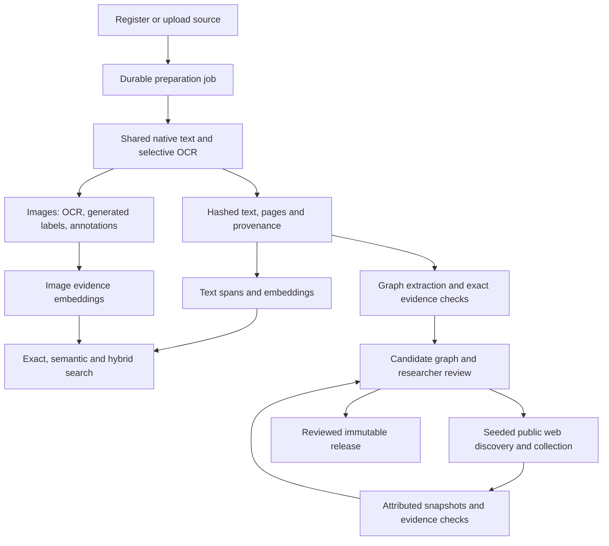

# Document preparation implementation and acceptance

Implemented on `codex/document-processing-poc`, 19 October 2026. Production remains on `codex/mvp-document-graphs` until staging acceptance. The approved Simplified Chinese, Traditional Chinese and Japanese Tesseract packs are the only added runtime dependencies. There are no database migrations, provider credential changes or production deployment configuration changes.

## Data flow



CPU parsing runs off the API event loop. Two preparation workers are bounded by per-material file locks. Graph jobs use a separate durable scheduler. Text and image indexing are independent after extraction. A graph stage checkpoint means that a run was registered/queued; it does not mean extraction or scientific review completed.

## Repeatable service contract

1. Upload commits the managed source and queues preparation. `POST /api/v1/repository/materials/{id}/process` reuses the current input/configuration fingerprint; `force: true` explicitly creates another preparation attempt.
2. The fingerprint covers source hashes, filenames/language, OCR engine/languages, shared parser implementation, graph prompt, image description recipe/model and embedding method identity. Source bytes are rechecked between stages and before completion. Changed inputs supersede the obsolete plan.
3. `document_representation.py` preserves immutable native/OCR outputs, exact text hashes, locators and confidence/warnings. Corrupt native PDF text falls back to OCR. Incomplete OCR remains retryable. Image descriptions remain a separate derived layer, never source quotations.
4. `processing_jobs.py` saves stage and per-item progress on the existing volume. Restart reuses completed stages and successful item indexes. At most three job attempts run automatically; explicit retry resets the budget. Failed IDs are excluded for the rest of a pass so healthy rows proceed. Completed retries clear stale failure messages.
5. Extraction refresh validates new text before replacing active evidence; observation-linked historical evidence survives. DOCX uses an XML adapter. Unicode filenames survive upload. Public-link extraction is bounded and destination/robots checked.
6. Full-coverage overlapping embeddings use existing vector columns. Exact/CJK search remains available without all vectors. Hybrid results retain lexical/cosine/fusion scores and locators. Generated answers are explicitly unverified drafts. OCR-only image evidence remains searchable while caption failures keep full image readiness incomplete; its unchanged vector is reused on retry.
7. Graph extraction selects exact spans and validates labels, references, ontology constraints and evidence ownership. Attempts are saved. Repair hints suggest lexically matching registered spans; a fresh response must pass the same validator. Partial valid candidates can be inspected but cannot be published. `POST /research-runs/{id}/retry` derives a new run from pinned bytes and current implementation.
8. Optional augmentation starts from document seeds, saves discovery/collection snapshots and lineage, and uses the same validator. Window-based candidate-yield/duplicate thresholds and a hard page cap stop collection. Comparisons remain reviewable proposals. See [graph recovery](graph-pipeline-recovery.md).
9. `GET /repository/materials/{id}/processing` returns stage and coverage. `POST /repository/processing-jobs/{job_id}/retry` resumes unfinished work. Source-to-graph navigation waits for the upload worker's registered graph instead of racing it with another provider run.

## Real-material acceptance checkpoint

The [saved POC and replay instructions](../../SampleReports/platform_service_fixes_2026-10-19/poc/README.md) record exact source hashes, IDs, staged commit and verification outputs.

The replay CLI is versioned as `scripts/run_document_processing_poc.py`; PDFs and run artifacts remain in workspace storage, outside Git. Example, from the backend:

```sh
.venv/bin/python scripts/run_document_processing_poc.py \
  --api https://tapa-research-workbench-backend-graph-staging.up.railway.app/api/v1 \
  --papers /absolute/path/to/the/four/papers \
  --output /absolute/path/to/pilot-artifacts
```

Reusing its output folder reuses material/file/run IDs. A new output folder creates a separate POC and may invoke configured providers. `--workbench-api` selects the repository API containing the Sulawesi reference. All 100 baseline quotations were independently rechecked against immutable unit hashes and exact Unicode offsets, in addition to graph endpoint/evidence ownership checks.

- Four Watanabe papers plus Sulawesi: **69 readable pages**, none omitted; low-confidence OCR flagged.
- **70/70 text segments embedded**; Chinese exact and semantic searches returned evidence.
- **124 candidate entities, 30 relationships, 100 quotations**, all five documents represented; graph side details and page-linked quotations visible in the browser.
- The graph is **partial/unreviewed**, with 12 batches awaiting correction. This establishes a working draft flow, not semantic completeness or publication readiness.
- At baseline, 82 images needed complete descriptions/indexing. OCR-only partial retrieval and safe failure diagnostics are subsequent hardening changes; text and graph remain useful independently.
- Baseline augmentation is disabled. Web collection has deterministic tests but needs a live staging acceptance run tied to document seeds.
- A separate tiny text fixture verified upload-triggered preparation and browser navigation: three entities/two relationships reached `awaiting_review`; opening the source graph kept the run count at exactly one. This exercises orchestration, not real-paper extraction accuracy.

## Focused checks

Use the existing backend environment, without reading or copying credentials:

```sh
.venv/bin/python -m unittest \
  test.test_processing_jobs test.test_document_representation \
  test.test_repository_indexing_pipeline test.test_repository_image_search \
  test.test_image_descriptions \
  test.test_knowledge_pipeline_processing test.test_knowledge_pipeline_service \
  test.test_knowledge_pipeline_adapters test.test_knowledge_pipeline_contracts \
  test.test_knowledge_pipeline_discovery test.test_knowledge_pipeline_graph \
  test.test_knowledge_pipeline_runtime test.test_research_runs -q
```

Regression coverage includes restart/retry, independent stages, input changes during work, locking/cancellation, failed-item fairness, passage-tail retrieval, Unicode/CJK search, description freshness/bounded failures, exact evidence/ontology checks, and augmentation budgets/lineage. Provider mocks verify program behavior, not live model quality. Frontend validation is `npm run build` plus focused ESLint; unrelated full-lint failures are tracked separately.

Before production promotion: paired staging acceptance; extraction acceptance on derived current-paper runs; new upload and worker restart; seeded augmentation; a labelled multilingual retrieval fixture and scientific claim inspection. Add external queues, schema changes or vector infrastructure only after measurements justify them.
