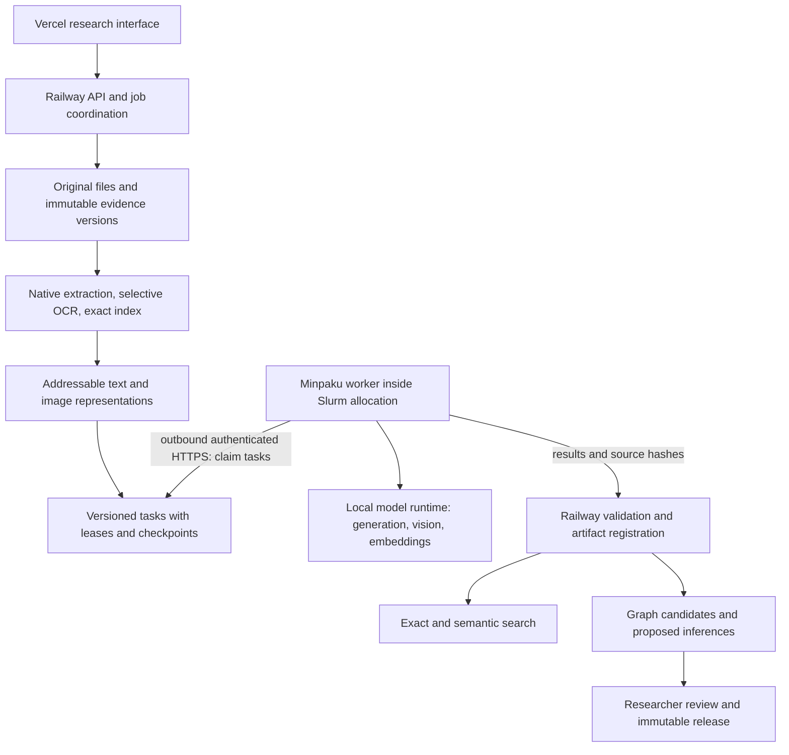

# Reliable document services and the Minpaku GPU

Assessed 21 October 2026. This runbook distinguishes working application code,
observed live state, and infrastructure that still needs provisioning. It does
not claim a self-hosted model is already connected to production.

## Decision

Use Minpaku for a centrally scheduled model worker, while Railway continues to
own application state, source metadata and job coordination. Keep Vercel as the
interface. Text extraction, selective OCR and exact search are CPU services;
they do not need Gemini or a GPU. One shared GPU should serve bounded batches,
with one heavy request at a time. Cloud inference becomes an explicitly enabled
fallback, rather than a requirement for every document.

The existing application already implements extraction, OCR, translation,
embedding, search, graph candidates, review and network composition. The main
problem is reliable execution, coverage and provider availability. Replacing the
model alone does not finish partial graphs, fill indexes or validate inferences.

## Evidence and current limitations

The inspected chat is **Diagnose Minpaku VPN access**. Its local handoff at
`/Users/zacpangan/Documents/ChatGPT/gpu-vpn connection/workstation-setup/`
records an RTX 5090 with 32 GB VRAM, Ubuntu 24.04 under WSL, an existing Slurm
`gpu` partition, and a successful PyTorch CUDA matrix multiplication. That is
evidence of GPU computation, not a deployed inference service. The setup uses
individual users and Slurm allocations. Shared-tools administrator installation
was left pending; the GPU notebook allocation has a two-hour limit.

A new read-only `ssh stl_workstation` attempt on 21 October stopped at the saved
VPN proxy: the Minpaku VPN DNS route was missing. No host configuration, keys,
accounts or model installation were changed. Current free VRAM, disk space,
runtime installation and network egress remain unverified until reconnection.

Production checks on the same date returned HTTP 200 for application, search,
graph capabilities and AI status. The small text-generation and embedding
probes passed. Production still reported:

| Measure | Observed count | Meaning |
| --- | ---: | --- |
| Eligible text segments | 1,408 | Extracted text eligible for the active semantic index |
| Current text segments indexed | 406 | Remaining semantic coverage is incomplete |
| Eligible image records | 589 | Not all necessarily useful figures |
| Current image vectors | 0 | 240 older image vectors are stale under the active policy |
| OCR-only searchable images | 69 | Existing text can be useful without a current visual vector |
| Production vision model | `llava` | Configuration only; no fresh image inference was performed by this audit |

Gemini quota failures were observed in earlier work; today's success does not
establish sustained capacity. The approved staging vision correction is separate
from production. No automatic production model-setting change is included here.

## Implemented in this change

* `/repository/ai/status` reports independent generation, embedding, translation,
  graph, image-description, OCR and exact-search capabilities. Provider probes,
  configuration, cached failure and task verification have different meanings.
  A responding text endpoint does not make translation/graph quality green.
* Sources displays the individual services and document index coverage.
  Similarity-index counts no longer imply that unembedded text is unsearchable.
* A durable optional `image_describe` processing stage reads image text and
  prepares descriptions **without requiring embeddings**. The per-document
  **Read and describe images** action selects it. Existing upload defaults and
  fingerprints are retained to avoid silently reprocessing the entire library.
* OCR is persisted before vision requests. A failed vision call retains OCR and
  the previous caption; missing OCR runtime is reported rather than treated as
  successful blank transcription. Source/context checks reject stale captions.
  Model-generated labels remain derived evidence, not quotations from papers.
* Per-image outcomes, bounded batches, progress and retry classifications are
  durable. A startup discovery error no longer kills processing of queued jobs.
* Provider caches include endpoint identity. Existing persisted vector identity
  is unchanged; changing an embedding model still requires a deliberate rebuild.
* `scripts/check_local_model_services.py` supplies bounded, synthetic tests for
  generation, schema-shaped exact-quote extraction, Chinese/Japanese translation,
  finite same-dimension embedding batches, and image input. It installs nothing.

No dependencies, database schema, credentials, environment files or deployment
configuration are changed. Hash-pinned graph/translation/representation modules
remain unchanged, so existing evidence and completed translations are preserved.

## Target service boundaries



The outbound leased-task transport in this diagram is the proposed next phase;
it is **not implemented or deployed by the status/image-stage patch**. The current
durable workers run beside the API and use its local storage. Do not mount or
copy a live SQLite database over the VPN, and do not run two independent queues
that both believe they own the same job.

The Railway process cannot reach a private Minpaku IP merely because this Mac
has GlobalProtect. Either an approved private gateway must connect the actual
Railway runtime, or a Minpaku worker must fetch tasks outward. The latter fits
Slurm and avoids making the browser or this laptop a permanent relay.

## Initial model evaluation set

Start with these inspectable local candidates; this is an evaluation choice,
not a measured winner on the Watanabe papers:

| Service | Initial candidate | Reason / constraint |
| --- | --- | --- |
| Entity/relation extraction, translation and cited answers | `qwen3:8b` | Multilingual; relatively small local baseline; exact evidence validation still mandatory |
| Observable image labels and difficult figure transcription | `qwen3-vl:8b` | Vision-language model; evaluate Chinese figures separately from generic image recognition |
| Text and image-label semantic retrieval | `qwen3-embedding:0.6b` | Small multilingual embedding baseline; image retrieval here embeds OCR/labels, not raw pixels |
| Native text / OCR | Existing PDF adapters and Tesseract `eng`, `chi_sim`, `chi_tra`, `jpn` | Local CPU work; preserve page locators and confidence/warnings |

The checked Ollama tags list approximately 5.2 GB for Qwen3 8B and 6.2 GB for
Qwen3-VL 8B. These are model-download sizes, not measured VRAM requirements.
Reserve at least 25 GB of approved **workstation** disk for the initial runtime,
model cache and temporary artifacts, then measure actual use. Do not place the
model cache on the 1 GB Railway production volume.

Use Ollama first because the existing Workbench already speaks its local API.
Local Ollama supports JSON-schema output; its Cloud documentation currently
states that structured outputs are unsupported. This can improve schema
conformance but cannot guarantee factual support. vLLM is a later throughput
option requiring its own environment, API adapter and benchmark; installing it
over the verified research environment would be inappropriate.

On one shared 32 GB card, initially run one model task at a time, load/unload
models between task groups, cap context/output and bound the queue. Batch
embeddings together instead of alternating models per paragraph. Increase
concurrency only after measuring peak VRAM and latency inside Slurm. An always-on
GPU endpoint would monopolize the allocation and requires an administrator-
approved reservation; the existing shared queue does not promise 24/7 service.

## Concrete provisioning proposal — approval required, not executed

1. Reconnect GlobalProtect and inspect `nvidia-smi`, available disk, Slurm limits,
   installed runtimes, reboot behavior and allowed outbound HTTPS. Reuse the
   existing SSH host and individual account; do not ask for passwords in chat.
2. In a dedicated user/project-owned inference location, install a pinned Ollama
   Linux runtime compatible with the GPU and the vision model. Verify the release
   checksum and record runtime/model digests before use. Do not change the shared
   Conda environment, grant sudo or create accounts as a side effect.
3. Download the three evaluation models above only after storage/download
   approval. Record the exact tag resolution/digest; mutable names alone are not
   a reproducibility guarantee.
4. Run the local runtime on loopback **inside** an approved Slurm allocation,
   using an unused port if the default is occupied. Initial settings: one loaded
   model, one parallel request and no unbounded queue. Preserve the existing
   allocation/time limits. Runtime and child processes must end with the job.
5. Execute the conformance command below, then a small held-out document test.
   Do not enable corpus-wide work merely because the synthetic fixtures pass.
6. Implement authenticated outbound task leases on Railway, a dedicated least-
   privilege worker identity, source-bound inputs/results and heartbeat recovery.
   This requires explicit authentication/deployment changes. Keep documents and
   tokens out of logs. No public unauthenticated model listener or temporary
   laptop tunnel should become the production route.
7. Switch staging first. Route each capability explicitly; remove Cloud
   credentials from the local runtime's requests rather than forwarding them to
   a new endpoint. Cloud fallback must be opt-in, bounded and visible per task.
8. Rebuild semantic indexes into a distinct embedding identity and verify query/
   document model, dimension, task prefix, chunking and normalization match.
   Keep the previous searchable index for rollback until acceptance. A different
   model must never write vectors under the old Gemini identity.
9. Roll out production after source/quotation/retrieval checks and a kill/restart
   exercise. Retain existing released graphs and translations; produce derived
   versions when a model or source changes.

## Programmatic preflight and regression checks

From the backend repository using its existing environment:

```sh
.venv/bin/python scripts/check_workbench_services.py \
  --base-url https://tapa-research-workbench-backend-production.up.railway.app \
  --probe-ai --output /tmp/workbench-services.json

.venv/bin/python -m unittest \
  test.test_service_readiness test.test_image_preparation \
  test.test_processing_jobs test.test_processing_api \
  test.test_local_model_services
```

On Minpaku, **after** the approved runtime/models are present and a Slurm
allocation is active, run the standalone checker with an available Python3:

```sh
python3 scripts/check_local_model_services.py \
  --base-url http://127.0.0.1:11434 \
  --chat-model qwen3:8b \
  --embedding-model qwen3-embedding:0.6b \
  --vision-model qwen3-vl:8b \
  --output /tmp/minpaku-model-services.json
```

It does not auto-download or install models. Results omit document contents,
credentials, response bodies and provider URLs. Every service is tested
independently; failure returns a nonzero exit code. The simple translation test
checks terminology only and explicitly still needs human review. The extraction
fixture is not the complete production graph validator or a quality benchmark.

## Full processing and acceptance contract

| Stage | Must produce | Acceptance / automatic behavior |
| --- | --- | --- |
| Registration | Material/file IDs, hash, original locator | Duplicate uploads reuse content; originals remain immutable |
| Extraction and OCR | Page-addressed text, OCR language/confidence/warnings | OCR only poor/empty native pages; report unreadable pages and preserve previous usable output |
| Figure preparation | Separate source caption, OCR, observable machine labels | Deduplicate informative figures; retain failed/skipped reason; never quote machine labels as paper text |
| Translation | English units linked to original units, model/version and term glossary | Preserve names, dates, negation and uncertainty; resume per unit; independent review status |
| Exact index | All readable original text and translated copies, with locators | Test Chinese/Japanese substrings, names and dates; extraction text is searchable without embeddings |
| Semantic index | Complete chunks and content/model/policy identity | Beginning/middle/end retrieval and CJK/English cross-language fixtures; no silent truncation or mixed spaces |
| Graph extraction | Typed source-local entities, assertions and exact supporting spans | Reject unsupported assertions/quotes; checkpoint all batches; distinguish partial from complete |
| Entity integration / inference | Reviewable typed comparisons with premises and source scope | Similar names never prove identity; inferred links remain separate from reported assertions |
| Augmentation | Document-derived seeds, attributed snapshots and validated additions | Bounded discovery, deduplication, relevance/yield stop rules; feed results through the same evidence validation |
| Search / answers | Ranked evidence and opening source/page citations | Exact fallback remains available; citation validation; embedding failure does not silently fabricate answers |
| Release | Reviewed immutable graph and coverage report | Completion is not researcher acceptance; preserve previous releases |

Start the held-out evaluation with original passages and figures from all four
Watanabe papers. Manually label a small Chinese/Japanese/English query set and
entity/relation set before testing candidate models. Record page completeness,
OCR character error, translation terminology/negation errors, grounded entity/
relation precision and recall, retrieval Recall@10, index coverage, seconds per
page, p50/p95 task latency, failed-task counts and peak VRAM. Do not select a model
solely because it emits more edges. Throughput/quality thresholds require a
baseline and team agreement, rather than invented claims of completeness.

## Remaining implementation work

The optional image stage is functional now, but a complete independent service
rollout still requires the authenticated Minpaku transport, admission control,
actual model installation/testing and embedding migration. Automatic translation
on upload and one unified coverage-aware orchestration policy are not included
in this patch. Graph preparation currently queues a child run; preparation being
done is not proof that all graph batches completed. Existing automatic graph
passes have a two-batch budget. Follow their run status and explicit coverage.

Next implementation sequence: worker transport/leases → single-GPU admission →
staging fixtures → staged index backfill → automatic translation policy → graph
coverage-aware continuation → corpus acceptance → production routing. Add a
separate vector database, Neo4j, reranker or larger model only when measured
retrieval/graph needs justify the additional service.

## Primary references checked 21 October 2026

* [Ollama local structured outputs and Cloud limitation](https://docs.ollama.com/capabilities/structured-outputs)
* [Ollama Linux installation and updates](https://docs.ollama.com/linux)
* [Ollama memory, concurrency and model lifetime controls](https://docs.ollama.com/faq)
* [Qwen3 8B Ollama tag](https://ollama.com/library/qwen3:8b)
* [Qwen3-VL 8B Ollama tag](https://ollama.com/library/qwen3-vl:8b)
* [Qwen3 embedding 0.6B Ollama tag](https://ollama.com/library/qwen3-embedding:0.6b)
* [Qwen3 multilingual embedding model card](https://huggingface.co/Qwen/Qwen3-Embedding-0.6B)
* [Slurm GPU resource allocation](https://slurm.schedmd.com/gres.html)
