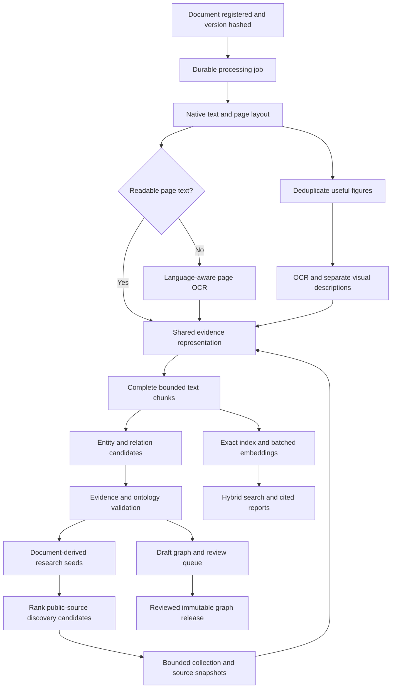

# Workbench service review and automation design

Reviewed 18 October 2026 (Japan time). This document distinguishes verified current behavior, the small fixes in this change, and proposed work. The proposed unified pipeline is not implemented by this change.

## Findings that determine the next work

The hosted API and its configured generation/embedding providers respond, but the platform is not yet one automatic processing pipeline. Upload, extraction, image processing, text indexing and graph ingestion have different triggers and representations. Improving handoffs and coverage should come before adding another model or database.

The production inventory at review time was 15 materials, 1,236 text segments, 114 text embeddings for the active model (9.2%), 794 image records and 229 current image embeddings (28.8%). These are inventory ratios, not quality scores; some small/decorative images may intentionally be excluded. The active text/image embedding identity is `gemini:gemini-embedding-001:768`, while generation is Ollama Cloud `gpt-oss:120b`.

All three existing production graph runs were paused: two at `awaiting_annotations` and one at `awaiting_readable_documents`. Sampled rejection logs identified non-exact quotations, unsupported labels and references to rejected entities. The sample covers up to three rejected batches per run, not every batch. No existing research run was resumed, edited or released in this review.

## Service inventory

| Service | Current path and behavior | Main gap / proposed improvement |
|---|---|---|
| Registration / uploads | `/repository/materials` and `/files`; existing metadata and managed storage | Upload does not start the whole processing chain. Emit a durable document-version job after a successful commit. |
| Text extraction | `/materials/{id}/extract`, `/extract-ready`; several local format adapters | Request-bound extraction and repeated representations. Extract once into a versioned, page/paragraph-addressable representation. |
| OCR | `ocr_image_file` in `app/api/repository.py`; stored with image evidence | OCR does not feed `extracted_segments` or graph ingestion. Detect scanned pages, use explicit language packs and a timeout, preserve OCR provenance and word/page positions. |
| Image descriptions | Repository image indexing combines OCR/caption/context evidence | Separate OCR transcription, visual description, nearby source caption and interpretation; failures must remain visible. Avoid describing decorative or duplicate images. |
| Text embeddings | `index_missing_segment_embeddings`; stored as JSON vectors in SQLite | Partial coverage, sequential calls, only the first 2,000 characters of a segment embedded. Create bounded chunks that cover all text and use content/model/version-aware incremental indexing. |
| Image embeddings | `index_missing_image_embeddings` and `search_image_evidence` | **Fixed in this change:** retrieval now uses the active embedding identity, matching indexing. Previously the Ollama-only filter hid Gemini-indexed images. |
| Exact search | SQLite FTS5-backed `/repository/search` | FTS exists already. Improve multilingual tokenization/fallback, literal-vs-advanced query parsing and index consistency checks. Two-character Chinese substrings need an explicit strategy; trigram alone is insufficient. |
| Semantic / multimodal search | `/ai/semantic-search`, `/ai/multimodal-search`; cosine scoring of stored vectors | Full vector scans and indexing in query paths. Precompute coverage; combine exact and semantic ranks with an evaluated fusion strategy; cache one query embedding across text and image branches. |
| Assisted answers / reports | `/ai/ask`, `/ai/evidence-report`, search reports | Distinguish embedding readiness from generation readiness, retain citations, validate answer-to-evidence support, and keep slow preparation outside interactive requests. |
| Observations / keywords | Existing observations and non-LLM keyword suggestions | Human observations remain a distinct evidence type. Changes should invalidate relevant derived artifacts without pretending they are original document text. |
| Knowledge graphs | `knowledge_pipeline/{adapters,service,processing,graph,store,jobs}.py` | Strong hashes, exact evidence checks, checkpoints and reviewed exports; separate PDF reparse ignores repository OCR/captions. Default ontology is tapa-specific. Use the shared representation and explicit project ontology selection. |
| Web augmentation | Document entities → seeds/queries → registered URLs → static snapshots → extracted concepts → comparisons | It is seeded from documents, but URL discovery is manual, collection is one bounded round, and alignment requires compatible types/labels. Add evaluated discovery/reranking and explicit stop rules; do not merge identities by label alone. |
| Job execution / health | Durable graph job files and restart recovery; other processing follows different patterns | Graph worker executes jobs serially; image-job progress is held in process memory. Generalize durable stage states, bounded workers, retries and metrics. `/health` only proves the API process responds. |

These paths cover the hosted Sources/Knowledge graph workbench. Legacy dataset/map/model-list routes remain registered in the API; their presence is not evidence they are healthy. They are outside the current document research flow and were not exercised end to end. Destructive operations, bulk corpus reprocessing, fresh external-page collection and generated reports were not run against production.

Additional isolated checks reproduced three ingestion defects that should be fixed before enabling bulk automation: repository DOCX extraction decodes ZIP bytes as ordinary text; forced extraction deletes the previous usable outputs before a replacement succeeds; and a document with more than 1,000 extracted images persists its results before failing image-job limit validation. These remain documented findings, not fixes in this change. Use explicit format adapters, atomic replacement and bounded image batches respectively. OCR and caption exceptions also collapse to empty strings, so current absence of text/description does not distinguish a blank page from a service failure.

## Proposed shared processing flow



The web branch reuses ingestion and validation but remains bounded by a run budget and seed lineage. It must not recursively generate unlimited collection tasks. Embeddings/search and graph extraction can run in parallel after the same representation is ready. OCR and native text for the same page must be reconciled before publication to avoid duplicate passages.

### Shared evidence contract

Each immutable representation should identify `material_id`, `file_id`, source hash/version, representation hash, method/version, original language, page/paragraph/table locator, optional bounding box, text and text hash. Image derivatives add image hash, figure/crop locator, OCR output, source caption and generated visual description as separate fields. Record warnings, missing pages and quality measurements. A model-generated description is derived evidence and cannot be quoted as a statement from the paper.

Graph evidence should refer to this exact representation version; citations continue to open the original source and relevant page. Reviewed graph releases remain pinned when a file is replaced. New OCR/text corrections create a new representation and mark dependent search indexes/drafts stale; they do not rewrite published quotations.

### Durable stage contract

Proposed stage key:

```text
SHA256(workspace + source_hash + representation_hash + stage_name
       + implementation_version + configuration_hash + model_identity)
```

Record `queued/running/succeeded/blocked/failed/cancelled`, dependency keys, attempt count, heartbeat/lease, timestamps, input/output hashes, counts, duration and an actionable error code. Persist the job before scheduling it. Reuse a successful artifact for the same key; enqueue downstream stages only after their dependencies commit. A browser reload must not start duplicate provider work.

Begin with the existing persistent-volume checkpoint/locking pattern. Keep CPU-heavy PDF/OCR work in a bounded process pool and network provider calls behind a separate concurrency/rate limit. Use short SQLite transactions around artifact references; do not hold a write transaction while waiting for OCR or a provider. Adopt a separate queue/database only when measured load or multiple workers justify it; those changes need a separate infrastructure decision.

Retry connection failures, 429 and transient 5xx errors with capped exponential backoff/jitter and a total attempt/time/token budget. Do not loop on missing OCR language packs, invalid document bytes or unchanged invalid annotations. A bounded correction attempt can receive the source span and validation errors; it must pass the same exact-evidence validator. After that, move the item to a review queue. Never weaken evidence checks to improve throughput figures.

### Provider compatibility

The current graph request sends a JSON schema through Ollama's `format` field (`processing.py:602`). Official Ollama documentation currently states that Cloud does not support structured outputs. Consequently, a successful generation health probe does not establish schema-constrained extraction capability. The observed invalid graph outputs are consistent with this limitation, but the review does not prove it caused every rejection. Use a separate provider capability check plus a small source-grounding fixture. Select an approved backend with verified constrained output, or use explicitly labelled best-effort JSON plus bounded correction and validation. Changing provider/model remains a proposal. [Ollama structured-output documentation](https://docs.ollama.com/capabilities/structured-outputs).

OCR should run only where native extraction is absent or poor, then reuse its output. PyMuPDF documents this selective, cached approach because OCR is substantially slower than native extraction. OCR language selection for the current Chinese/Japanese/English materials is essential. [PyMuPDF OCR guide](https://pymupdf.readthedocs.io/en/latest/recipes-ocr.html).

Batch embedding requests when the configured provider supports them; store provider/model/dimensions/task and normalization policy as one index identity. Index and query must use the same model identity, as the fixed image-search regression demonstrates. [Ollama embedding documentation](https://docs.ollama.com/capabilities/embeddings).

### Search and indexing design

First close coverage and truncation gaps, then benchmark. Retain FTS5 for exact/phrase discovery and add safe query handling and tested multilingual behavior. If derived content lives in an external-content FTS table, updates/deletions and initial backfills must keep the index synchronized; include integrity checks. [SQLite FTS5 documentation](https://www.sqlite.org/fts5.html).

Split long passages by structure within the embedding model's token limit, preserving parent offsets and modest overlap. Record coverage of every parent span; do not silently embed only the beginning. Batch provider calls and avoid repeating embeddings for identical content. Cache query embeddings, then rank exact and semantic candidates together while retaining both scores, provenance and filters. Add reranking only after a labelled retrieval evaluation shows a benefit. Introduce an approximate vector index only if measured corpus size/latency requires it; JSON-vector full scans are manageable at small scale but grow with every stored vector.

Graph entities, aliases and accepted assertions should become an additional searchable layer that links back to passages. Preserve the distinction between a source quotation, a candidate entity, a curated relationship and a generated answer. A graph hit should expand to neighbouring evidence without replacing passage retrieval.

### Graph and augmentation design

Preserve source-local entities, exact supporting quotations, type/predicate validation, uncertainty, case/time/place scope and immutable reviewed releases. Choose a versioned ontology template per project; a tapa ontology should not silently govern every linguistic or museum document.

For reliable extraction, prefer selecting existing span IDs/offsets over asking the model to reproduce long passages. Derive quotations deterministically from immutable text, check span bounds, then validate that the entity/relation is actually supported. Separate entity and relation passes if evaluation shows better grounding. Cross-chunk coreference and bilingual aliases remain reviewable proposals with both sides' evidence.

Automatic augmentation should prioritize uncovered document seeds and questions, discover public source candidates, rank relevance/authority/novelty, fetch a bounded static snapshot, and use rendered-browser collection only when static extraction lacks required content. Hash and attribute each acquired representation. Report seed coverage, successful pages, duplicate rates, validated novel candidates and accepted comparisons. Expand alignment candidate generation with checked aliases/translation/semantic similarity while maintaining type, time, place and ambiguity constraints; similarity proposes a comparison, not identity.

The existing hosted service records average candidate yield after one round; it does **not** implement iterative saturation. A future explicit stopping configuration could use a five-successful-page rolling window, a minimum of ten successful pages, fewer than one validated novel candidate per page across two windows, a duplicate ceiling and a hard page/time/token budget. These numbers are provisional tuning parameters, not scientific evidence of completeness. Relevance and acceptance rates must be measured separately from quantity.

## Implementation order and acceptance criteria

| Priority | Work | Evidence required before rollout |
|---|---|---|
| P0, this change | Active-model image-search fix; restore graph side details and structural insights | Gemini and Ollama index→search regression; material/method filtering; desktop and narrow-screen UI checks. |
| P1 | Safe extraction replacement, explicit DOCX adapter and capped image-job batches | Failed refresh preserves prior evidence; DOCX emits paragraph/table text; 1,001-image fixture completes via bounded batches without post-commit failure. |
| P1 | Shared native/OCR representation consumed by search and graph | A scanned Chinese/Japanese fixture is searchable and yields page-linked graph candidates; original text/description provenance stays separate. |
| P1 | Complete versioned chunking and incremental embedding backfill | Beginning/middle/end retrieval tests, no silent truncation, eligible coverage counts and retryable failures, zero unnecessary provider calls on replay. |
| P1 | Provider extraction capability and bounded grounding repair | Fixture schema/evidence validation, saved rejection diagnostics, configured cost/retry ceiling, no unchecked candidates. |
| P2 | Durable upload-triggered pipeline with stage progress | Crash/restart, repeated-upload, two-worker and cancellation tests; no duplicate stage execution or lost work. |
| P2 | Multilingual literal/advanced FTS, hybrid search and evidence ranking | Labelled Chinese/Japanese/English queries; Recall@10, nDCG@10, p50/p95 latency, filters and quote-source accuracy compared with current baseline. |
| P2 | Seed-driven automatic discovery and reviewed graph indexing | Seed coverage and relevance gains on fixed source fixtures; missing/contradictory claims preserved; collection hard budgets and replay without recollection. |
| P3 | Capacity changes based on measured bottlenecks | Benchmark CPU/memory, queue age, throughput and cost per document; justify additional database, vector index or worker infrastructure. |

The UI should show per-document readiness (text/OCR, images, index coverage, graph candidates, review) and a single processing action with visible stage progress. Advanced controls remain available. The graph keeps a side inspector for entity context, incoming/outgoing connections, quotations and review; insights explain types, unlinked concepts, source coverage and comparison counts without implying scientific completeness.

## Reproduce the checks

From the backend repository, using its existing virtual environment:

```bash
.venv/bin/python scripts/check_workbench_services.py \
  --base-url https://tapa-research-workbench-backend-production.up.railway.app \
  --output /tmp/workbench-services.json --probe-ai
.venv/bin/python -m unittest test.test_repository_image_search
.venv/bin/python -m unittest test.test_knowledge_pipeline_service test.test_knowledge_pipeline_processing test.test_knowledge_pipeline_graph test.test_knowledge_pipeline_contracts test.test_research_runs test.test_knowledge_pipeline_runtime
```

The service checker uses GET requests, omits document contents and credentials from its output, and performs provider health requests only with `--probe-ai`. HTTP 200 establishes reachability, not extraction accuracy. It does not alter source documents, initiate indexing, resume jobs or publish graphs. Store timestamped results and compare inventory/coverage across releases. Local regression fixtures use synthetic data and mocked providers; passing them is not a live model quality evaluation.

Detailed audit evidence is saved alongside this review in the workspace's `SampleReports/platform_service_review_2026-10-18/`: `hosted-checks.json`, `graph-run-diagnostics.json`, `processing-audit.md` and `search-index-audit.md`.
